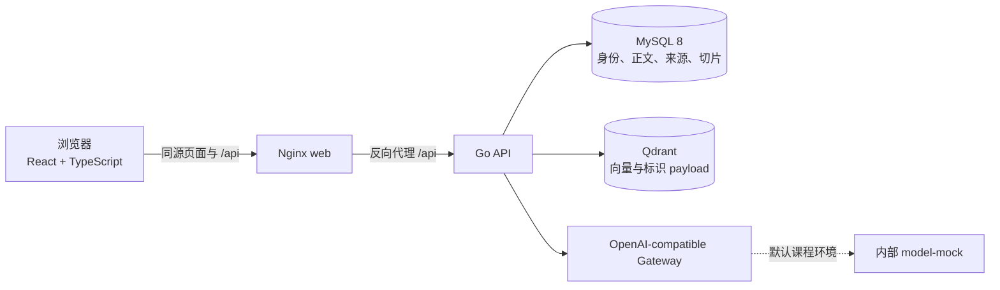
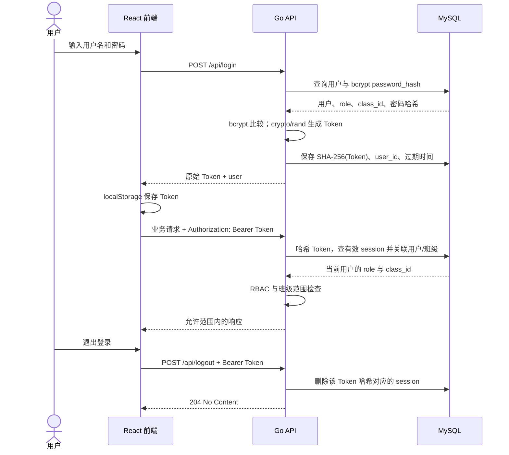

# 《CampusClaw 基于 Token 的身份认证与知识库问答实现方案》

课程：第五课课后作业<br>
项目：CampusClaw<br>
整理依据：当前仓库中的 Go API、React 前端、MySQL migrations、Compose 配置、验收脚本和第 3、4 课 OpenSpec。

## 1. 项目背景与整体架构

CampusClaw 是一个按班级隔离教学材料和知识内容的课程项目。教师登录后可以上传 UTF-8 的 `.txt`、`.md` 材料；系统保存原材料及对应知识正文，并把正文切成可追溯片段。教师和学生都可以检索、提问，但每次访问的数据范围由当前登录用户所属班级决定。

项目主要组件如下：

| 组件 | 当前实现中的职责 |
|---|---|
| React + TypeScript | 登录、材料列表与下载、教师上传、知识检索和知识问答界面；通过统一 API 封装发送 Bearer Token。 |
| Nginx（Compose 的 `web`） | 提供前端静态资源，并把同源 `/api` 请求转发给 Go API。 |
| Go API | 登录和会话校验、RBAC、班级范围控制、文件接收、切片、embedding 调用、检索融合及问答编排。 |
| MySQL 8 | 保存用户、会话哈希、材料、知识正文和切片正文/来源信息，是正文及关系的权威数据源。 |
| Qdrant | 保存切片向量和用于关联、过滤的标识 payload，供向量检索使用。 |
| OpenAI-compatible Model Gateway | Go 服务调用的 embedding 与 chat HTTP 接口。Compose 默认使用内部确定性 `model-mock`，用于可重复验收；它不是真实大模型。 |
| Docker Compose | 启动 `web`、`api`、`db`、`qdrant` 和 `model-mock`，配置健康检查与持久化卷。只有 `web` 发布宿主机端口；其余服务在 Compose 网络内部通信。 |

整体链路可以概括为：



## 2. 基于 Token 的身份认证实现方案

### 2.1 登录流程

前端提交用户名和密码到 `POST /api/login`。Go API 调用 `Store.Authenticate`，从 `users` 与 `classes` 查询用户及 `password_hash`，再用 bcrypt 比较密码。用户名不存在或密码不匹配时，接口统一返回 HTTP 401 和 `invalid username or password`，不返回密码哈希。

认证成功后，API 创建服务端 session，返回一次原始 Token 以及嵌套的 `user` 对象。前端收到结果后保存 Token，并根据响应中的用户信息显示页面；前端身份选择只用于登录体验，不参与服务端授权。

### 2.2 Token 的生成方式

`server.go` 中的 `randomToken(32)` 使用 `crypto/rand` 产生 32 个随机字节，再用 `base64.RawURLEncoding` 编码为 URL-safe 字符串。它是无业务含义的 opaque Token，服务端不把 role 或 class_id 编码在 Token 内。

### 2.3 Token 在数据库中的安全存储

登录响应只返回原始 Token。`store.go` 中 `tokenHash` 对 Token 做 SHA-256，并将十六进制哈希写入 `sessions.token_hash`；数据库不保存原始 Token。会话记录还保存 `user_id`、`expires_at` 和 `created_at`。当前默认 session 有效期为 24 小时，可由 `SESSION_TTL_HOURS` 配置。

该设计降低数据库只读泄露时直接获得可用 Token 的风险，但不代表数据库或应用日志的所有风险都自动消失。当前实现没有 refresh-token 流程，也没有单独的 Token 轮换接口。

### 2.4 Authorization: Bearer `<token>`

前端的 `authorizedFetch` 从 `localStorage` 读取 `campusclaw_token`，在受保护请求中设置：

```http
Authorization: Bearer <token>
```

当前实现不是依赖 Cookie 的认证。`scripts/verify.ps1` 专门检查只带旧式 `Cookie: campusclaw_session=...` 的请求仍得到 401。登录请求本身不需要已有 Token；登录后 `/api/me`、材料、搜索、问答、上传和注销请求由统一封装附加 Bearer 头。

### 2.5 服务端如何恢复当前用户

`auth` middleware 读取并解析 Authorization 头，要求认证方案为 `Bearer` 且 Token 非空。随后 `Store.UserBySession` 对收到的原始 Token 重新计算 SHA-256，在 `sessions` 中查找哈希相等且 `expires_at > NOW()` 的记录，再通过 `user_id` 关联查询 `users` 和 `classes`。

恢复出的 `User` 包含 `id`、`username`、`role`、`class_id` 和 `class_name`，放入本次 HTTP 请求的 context。后续 handler 使用 `currentUser` 取得身份。无 Token、格式错误、无效或过期 Token 均返回 HTTP 401。

### 2.6 role 与 RBAC

`users.role` 的数据库枚举为 `teacher` 或 `student`。`teacher` middleware 在服务器端检查当前 session 对应用户的 role；上传材料和重建索引路由都经过该中间件。有效学生访问教师操作得到 HTTP 403。网页隐藏学生的上传控件只是界面行为，不构成安全边界。

客户端提交的 `role`、`user_id` 不会覆盖 session 里的用户身份。登录页如果选择的身份与服务器返回 role 不一致，前端只提示账号实际类型，随后仍使用服务器返回的 user；服务器端权限继续由 role middleware 判定。

### 2.7 class_id 班级隔离

业务 handler 不以请求参数中的 class_id 确定班级，而使用认证 middleware 恢复的 `currentUser.ClassID`。材料列表 SQL 按该 class_id 过滤；材料详情和文件查询同时检查材料 ID 与 class_id。知识检索中，MySQL keyword 查询、Qdrant 向量 filter 和向量命中回 MySQL 的查询都使用同一个服务端 class_id。

因此，伪造 JSON、query string 或 header 中的 `class_id=B` 不能切换数据范围；伪造 `role=teacher` 也不能取得教师权限。跨班材料 ID 与不存在的 ID 对外均为 404，避免通过响应区分对象是否存在。

### 2.8 注销与 Token 撤销

`POST /api/logout` 受认证 middleware 保护。API 从 Authorization Bearer 头取出 Token，对其计算哈希并删除 `sessions` 中对应行，成功返回 HTTP 204。随后再次使用同一 Token 请求 `/api/me` 会因为 session 查询不到而返回 401。过期 session 在鉴权查询时不再有效；当前代码未实现周期性清理过期行。

### 2.9 前端 Token 保存和请求封装

`frontend/src/api.ts` 提供 `setToken`、`getToken`、`clearToken` 和 `authorizedFetch`。Token 当前保存在浏览器 `localStorage`，登录后设置，注销时清除；组件启动时用 `GET /api/me` 检查现有 Token 对应的身份。API 方法通过同一请求封装调用登录、注销、当前用户、材料、检索、问答和下载接口。

把 Bearer Token 放在 `localStorage` 是本课程应用的现状，代码并没有实现 HttpOnly Cookie、Token 加密存储、refresh token 或专门的 XSS 防护方案。浏览器脚本若能执行，可能读取 localStorage；这是当前实现的安全权衡。

### 2.10 安全设计小结

- 密码使用 bcrypt 哈希，数据库字段为 `password_hash`。
- 原始 Token 使用密码学安全随机数生成；数据库只保存 SHA-256 哈希。
- 受保护 API 使用 Bearer Token，不依赖 Cookie。
- session 有过期时间，注销时删除 session 记录。
- role 与 class_id 从服务端 session 关联的用户记录恢复，忽略客户端伪造值。
- 教师操作在 Go handler 的 RBAC 中校验；前端隐藏入口不代替服务器校验。
- SQL 使用参数绑定；材料上传限制文件扩展名、UTF-8、非空和大小。
- API key 通过服务端环境变量供 Go 客户端使用，不写入前端请求封装。Compose 没有给 Qdrant 或 model-mock 配置宿主机端口。
- 当前通用 HTTP 响应头代码设置 `X-Content-Type-Options: nosniff` 和 `Referrer-Policy: same-origin`；不要把未实现的 CSP、WAF、MFA 或 refresh token 写成现有能力。

Token 认证过程：



## 3. 基于知识库的问答实现方案

### 3.1 材料上传和 knowledge_entries

教师以 Bearer Token 调用 `POST /api/materials`，路由先经过认证及 teacher middleware。API 限制请求体大小，只接收 `.txt`、`.md`，要求内容非空且为有效 UTF-8，并规范化标题、生成随机存储文件名。

API 先写临时文件，再开启 MySQL transaction，插入 `materials` 和对应的 `knowledge_entries`，将临时文件改名后提交事务。索引发生在这一步之后；embedding 或 Qdrant 失败不会删除已经提交的材料、文件和知识正文。上传响应会带 `index_status`，索引失败时可由教师调用重建接口恢复。

### 3.2 chunk 切片

`chunking.go` 提供三种策略：

| 策略 | 规则 |
|---|---|
| auto | 默认最大 800 个 Unicode 字符，重叠 80 个字符；优先选择空行、换行、中文句号边界，边界不合适时按窗口切分。 |
| custom | `max_length` 为 100–2000，`overlap_percent` 为 0–50，分隔符为 newline、blank-line 或 period；可选择移除 URL/邮箱或折叠空白。 |
| hierarchy | 识别 Markdown `#`、`##`、`###` 标题，标题留在相应 section；较长 section 再用 auto 窗口切分。 |

切片函数返回有序 `ChunkDraft`，包含 `Index`、`Text`、`StartOffset`、`EndOffset`。偏移按 Go rune/Unicode 字符计数，使用左闭右开区间；custom 预处理开启时，offset 对应预处理后的切分文本，不能当作原文件字节位置。预处理不会改写 `knowledge_entries.content`。

### 3.3 knowledge_chunks

迁移 `002_knowledge_chunks.sql` 增加 `knowledge_chunks`。它将切片正文、班级、材料、知识条目、序号、字符区间、索引状态保存在 MySQL。状态为 `pending`、`ready`、`failed`。唯一约束 `(knowledge_entry_id, chunk_index)` 防止同一知识条目出现重复序号；class/status、material 有普通索引，`chunk_text` 使用 MySQL ngram FULLTEXT。Compose 将 MySQL `ngram_token_size` 设为 2。

MySQL 是正文与来源关系的 authoritative store。检索结果中的 excerpt、材料标题及来源信息从 MySQL 查询，不从 Qdrant payload 获取。追溯关系为：

```text
knowledge_chunks → knowledge_entries → materials → 原始上传文件
```

### 3.4 embedding

Go `ModelClient.Embed` 使用配置的 embedding base URL、model 和可选 API key，请求 OpenAI-compatible `/embeddings`。HTTP client 有配置超时，响应读取有大小限制，并检查返回数量、索引及向量维度；embedding 维度必须与服务配置和 Qdrant collection 配置一致。

上传索引时按 chunk 正文生成向量；向量查询时对 query 生成向量。keyword 检索路径不调用 embedding 服务。Compose 默认连接内部 `model-mock`；生产 provider 可通过环境配置替换，但代码只描述兼容接口，不代表当前部署正在调用真实模型。

### 3.5 Qdrant 向量索引

API 启动时检查或创建 `campusclaw_chunks` collection，使用 Cosine 距离和配置维度。每个 Qdrant point id 等于 MySQL `knowledge_chunks.id`。payload 保存关联标识：`class_id`、`material_id`、`knowledge_entry_id`、`chunk_id`、`chunk_index`，不保存 chunk 正文、材料标题、文件内容或 API key。Qdrant 不发布宿主机端口，供 API 在 Compose 内部访问。

### 3.6 keyword retrieval

keyword 模式使用 MySQL `MATCH(chunk_text) AGAINST (... IN NATURAL LANGUAGE MODE)`。查询只选当前 class_id 且 `index_status='ready'` 的 chunks，按 FULLTEXT relevance 排序，并应用 `KEYWORD_MIN_SCORE` 绝对阈值（默认 0.01）。该路径不请求 embedding，也不访问 Qdrant；所以 Qdrant 故障时 keyword 仍可以工作。

### 3.7 vector retrieval

vector 模式先对 query 做 embedding，再调用 Qdrant 搜索。请求包含从 session 恢复的 class_id payload filter 和分数阈值，默认 `VECTOR_MIN_SCORE=0.35`。低于 0.35 的 cosine 候选不返回。Qdrant 返回的 point id 随后回 MySQL 查询，并再次要求 chunk 属于同一个 session class_id 且状态为 ready；摘录和材料标题从 MySQL 读取。

### 3.8 hybrid retrieval

hybrid 分别执行 keyword 与 vector 路径，两路先各自执行阈值、ready 状态和班级过滤，再把保留候选合并。默认搜索模式为 hybrid。调用者可以显式选择 keyword；若 hybrid 所需的 embedding 或 Qdrant 不可用，当前 API 返回 HTTP 503，不静默降级成 keyword。

### 3.9 RRF 融合

融合按排名而不是原始全文分数和余弦分数计算，常数 `k=60`：

```text
RRF(chunk) = Σ 1 / (60 + rank_path(chunk))
```

排名从 1 开始，未出现在某一路的候选不从该路获得分数。比如一个 chunk 在 keyword 与 vector 两路都排第 1，则融合分数为 `1/61 + 1/61 = 2/61`。若分数相同，当前实现依次使用最佳单路排名和 chunk id 稳定排序。

### 3.10 class_id 检索隔离

`POST /api/knowledge/search` 和 `/api/ask` 都受 auth middleware 保护。两者将 `currentUser.ClassID` 传给检索服务；客户端 JSON 中即使带有 class_id，也不会传入检索服务作为范围。MySQL keyword WHERE、Qdrant vector filter 和向量结果的 MySQL 回表均使用 session class_id。

因此 A 班用户查 B 班独有内容时返回 HTTP 200 空结果和固定提示，不返回跨班内容，也不通过 403/404 揭示其存在。直接访问跨班材料 ID 则沿用 Lesson 3 的 404 规则。

### 3.11 来源追溯

每个 `SearchHit` 返回 `material_id`、`material_title`、`knowledge_entry_id`、`chunk_id`、`chunk_index`、`start_offset`、`end_offset`、MySQL `chunk_text` 形成的 `excerpt`、受保护的 `material_url`、rank 和 score；hybrid 结果还可包含 keyword/vector 两路排名。材料文件 URL 仍要求有效 Bearer Token 且班级匹配。

### 3.12 `/api/ask`

`POST /api/ask` 接受 messages 数组。服务端从末尾向前找到最新一条 `role=user` 消息，将其作为 query，固定执行本班 hybrid 检索，最多取前 4 个结果。空的最新用户问题返回 HTTP 400；缺少或无效 Token 返回 HTTP 401。

### 3.13 服务端 Prompt 与 3.14 Top-K Evidence

没有命中时不会构造 evidence prompt，也不会请求 chat。命中时，`buildEvidencePrompt` 按最终检索顺序把每个片段写成编号证据，附上材料标题、chunk 序号、chunk 正文和最新问题。系统指令要求模型只根据编号资料简短作答，并使用 `[1]`、`[2]` 标注出处。API key、向量和 Qdrant point 不会作为回答证据发送给浏览器。

当前实现只将最新 user 问题与服务端 evidence prompt 传给 chat client；不会把客户端 system 消息或旧对话轮次转交模型。

### 3.15–3.16 回答引用与 citations

Chat client 请求为非流式 OpenAI-compatible `/chat/completions`，将 system instruction 和 evidence prompt 分别作为 system/user message。成功后 `/api/ask` 返回单个 JSON 对象：`answer` 是模型文本，`citations` 是同一顺序的检索 hits。前端保留回答中的 `[1]`、`[2]` 标记，并按 citations 顺序显示材料名、chunk index、offset 和 excerpt。

服务端的 citations 来自检索命中；当前实现请求模型按证据编号引用，但没有另行解析回答文本并拒绝缺失或错误编号。因此文档不把引用格式校验描述为后端已实现能力。

### 3.17 无有效依据时不调用 Chat Model

如果 hybrid 检索没有合格候选，API 直接返回 HTTP 200：

```json
{
  "answer": "资料中未找到相关内容",
  "citations": []
}
```

验收脚本通过重置并读取 mock stats 检查 chat 调用计数仍为 0。无关问题仍会产生一次 query embedding 请求，因为向量检索需要先计算 query 向量；“不调用 Chat Model”不等同于“不进行检索”。

问答整体流程：

```mermaid
flowchart TD
    U[教师上传 TXT / MD] --> V[Go 校验文件与权限]
    V --> T[MySQL transaction\nmaterials + knowledge_entries]
    T --> C[按 auto / custom / hierarchy 切片]
    C --> P[MySQL 写入 pending knowledge_chunks]
    P --> E[Embedding Gateway\n生成向量]
    E --> Q[Qdrant upsert\npoint id = chunk id]
    Q --> R[MySQL 标记 ready]
    R --> S[用户携 Bearer Token 提问]
    S --> I[恢复 session user 与 class_id]
    I --> K[Hybrid 检索\nKeyword + Vector]
    K --> F[各路阈值/班级过滤\nRRF k=60，最多 Top 4]
    F -->|无有效命中| N[HTTP 200\n固定无命中文案\ncitations = []\n不调用 Chat]
    F -->|有有效命中| D[Go 组织服务端 evidence prompt]
    D --> G[Chat Gateway\n非流式回答]
    G --> O[answer + 有序 citations]
    O --> M[前端显示 [1] / [2]\n和 MySQL 来源片段]
```

## 4. 核心接口

下表取自 `server.go` 路由注册与对应 handler。除登录和 health 外，表中业务接口均需要有效 Bearer Token。

| 方法与路径 | 权限/输入 | 当前实现行为 |
|---|---|---|
| `GET /health` | 无需登录 | 查询 MySQL 连通性；成功 200，数据库不可用 503。 |
| `POST /api/login` | JSON `username`、`password` | 成功返回 `{token, user}`；凭据错误 401，字段缺失 400。 |
| `POST /api/logout` | Bearer Token | 删除当前 session，成功 204。 |
| `GET /api/me` | Bearer Token | 返回当前 user 的 id、username、role、class_id、class_name。 |
| `GET /api/materials` | Bearer Token | 返回当前 class_id 的材料列表；客户端 query class_id 不改变范围。 |
| `GET /api/materials/{id}` | Bearer Token | 返回本班材料信息；不存在或跨班均 404。 |
| `GET /api/materials/{id}/file` | Bearer Token | 下载本班原文件；不存在或跨班均 404。 |
| `POST /api/materials` | 教师 Bearer；multipart `file`，可选 `title` | 校验并保存文件、材料和知识条目；随后启动 auto indexing，响应包含 `index_status`。 |
| `POST /api/materials/{id}/reindex` | 教师 Bearer；ChunkOptions JSON | 在当前教师班级内按 auto/custom/hierarchy 重建索引；学生 403，跨班/不存在 404。 |
| `POST /api/knowledge/search` | Bearer；`query`，可选 `mode` | 模式为 keyword/vector/hybrid，默认 hybrid；最多返回 10 hits；空 query/非法 mode 400，无命中 200 和固定 message，向量依赖故障 503。 |
| `POST /api/ask` | Bearer；`messages` | 最新 user message 作为 query；执行 hybrid Top 4。无命中返回固定 answer 和空 citations；有命中时返回非流式 answer 与 citations。 |

前端 `api.ask(question)` 实际发送：

```json
{"messages":[{"role":"user","content":"问题文本"}]}
```

前端统一请求封装从 localStorage 读取 Token 并设置 Authorization 头，不附加 system prompt。

## 5. 数据模型

字段根据 `backend/migrations/001_schema.sql`、`002_knowledge_chunks.sql`、Go `User`/`Material` 类型和 `Store` 查询整理。数据库 ID 均为 `BIGINT`，主表使用 `AUTO_INCREMENT`。

| 表 | 当前主要字段与约束 | 用途 |
|---|---|---|
| `classes` | `id`、`name VARCHAR(100) UNIQUE`、`created_at` | 班级实体。seed 当前包括 A 班与 B 班。 |
| `users` | `id`、`username VARCHAR(100) UNIQUE`、`password_hash VARCHAR(255)`、`role ENUM('teacher','student')`、`class_id` 外键、`created_at`；`idx_users_class` | 账号、bcrypt 密码哈希、服务器权限角色和所属班级。 |
| `sessions` | `id`、`token_hash CHAR(64) UNIQUE`、`user_id` 外键（删除用户时级联）、`expires_at`、`created_at`；`idx_sessions_expiry` | 服务端 session；只存 Token 的 SHA-256 十六进制哈希。 |
| `materials` | `id`、`class_id` 外键、`uploader_id` 外键、`title VARCHAR(200)`、`original_filename VARCHAR(255)`、`stored_filename VARCHAR(255) UNIQUE`、`created_at`；`idx_materials_class_created` | 材料元数据与上传文件名映射。实际文件保存在配置的上传目录/Compose volume。 |
| `knowledge_entries` | `id`、`material_id UNIQUE` 外键（材料删除时级联）、`class_id` 外键、`content MEDIUMTEXT`、`created_at`；`idx_knowledge_class` | 与材料关联的完整知识正文。 |
| `knowledge_chunks` | `id`、`knowledge_entry_id`/`material_id`/`class_id` 外键、`chunk_index`、`chunk_text MEDIUMTEXT`、`start_offset`、`end_offset`、`index_status ENUM('pending','ready','failed')`、`created_at`；entry/index 唯一、class/status/material 索引及 ngram FULLTEXT | 切片正文、检索状态和来源位置。只有 ready chunks 参与检索。 |

Qdrant 不属于关系型数据表；其 point id 与 `knowledge_chunks.id` 相同，payload 只提供上述关联需要的标识，不作为正文存储。

## 6. 安全性设计

1. **密码安全**：`Authenticate` 用 bcrypt 比较 `password_hash`，seed 密码也以 bcrypt 默认 cost 生成哈希；登录失败不区分未知用户名和错误密码。
2. **Token 安全**：Token 由 `crypto/rand` 生成；MySQL 仅存 SHA-256 哈希。session 查询还检查过期时间，注销删除 session 使 Token 失效。
3. **传递方式**：受保护 API 要求 `Authorization: Bearer <token>`。Cookie 单独出现不认证。浏览器端保存在 localStorage 的选择存在 XSS 暴露风险，当前代码没有实现 HttpOnly Cookie 或 Token refresh。
4. **RBAC**：上传与 reindex 在 API 路由处由 teacher middleware 检查。学生即使在请求中提交伪造 `role=teacher` 也会被 403 拒绝；脚本还检查拒绝后材料数、知识条目数和上传文件数不变。
5. **班级隔离**：class_id 来自 Token 对应 session 的 user 记录。材料读取、MySQL keyword、Qdrant filter 和 MySQL 回查都再次约束班级；客户端 class_id 不作为授权依据。
6. **数据库访问**：业务查询主要使用 SQL 参数绑定。跨班材料 ID 与不存在 ID 统一返回 404。
7. **文件输入**：只接受 `.txt`、`.md`；限制请求和文件大小、拒绝空文件和无效 UTF-8；存储名随机生成，不直接信任客户端路径。
8. **模型密钥**：embedding/chat key 由 Compose 环境变量传给 API 服务，Go 客户端在有 key 时以 Bearer 方式请求 gateway。前端 bundle 和 API 响应不需要这些 key。这里描述的是密钥配置位置，不等于 gateway 本身具备代码未实现的额外鉴权。
9. **内部服务**：Compose 只给 `web` 配置宿主机端口；`db`、`api`、`qdrant`、`model-mock` 均不映射宿主机端口。浏览器通过 web 同源代理访问 API，不直接访问 Qdrant/model-mock。

## 7. 测试与验证

仓库中的 `scripts/verify.ps1` 对运行中的 Compose 环境执行两组验收。验证记录保存在 `docs/iteration-1-verification.md` 和 `docs/iteration-2-verification.md`。最近一次 Lesson 4 完整验收结果为：

```text
LESSON3_SUMMARY PASS=22 FAIL=0
LESSON4_SUMMARY PASS=22 FAIL=0
```

代表性案例包括：

| 验证点 | 验证行为 |
|---|---|
| Bearer 身份认证 | 缺失、Basic、空 Bearer、随机 Token 请求均为 401；错误密码为 401；正确登录能由 `/api/me` 恢复用户、role 和 class。 |
| 注销撤销 | `/api/logout` 返回 204；同一 Token 随后访问 `/api/me` 返回 401。只带旧式 Cookie 返回 401。 |
| RBAC 与副作用 | 学生伪造 `role=teacher` 上传得到 403，materials、knowledge_entries 和 uploads 计数不变。 |
| 班级隔离 | A 班带 `class_id=2` 查询 B 班独有内容仍无命中；A 班直接访问 B 班材料 ID 得到 404；B 班自己的 Token 可以查到 B 班内容。 |
| keyword / vector / hybrid | keyword 检索时 embedding/chat mock 调用数为 0；vector 语义样例超过 0.35；hybrid 两路排名均为 1 时分数核对为 `2/61`；缺省 mode 为 hybrid。 |
| 问答无命中 | 无关问题返回固定文案、空 citations，chat 计数为 0。query embedding 仍会发生，以便执行向量检索。 |
| 问答证据输入 | 只用最新 user 问题；客户端 system 和较早 user 内容未进入 mock chat 输入；答案包含 `[1]` 且 citations 指向本班安全培训片段。 |
| 依赖故障 | model-mock 停止时上传材料、文件和知识正文被保留，chunk 标为 failed；恢复后教师 reindex 可收敛为 ready。Qdrant 停止时 keyword 继续成功，vector、hybrid、ask 返回 503。 |
| 持久化 | `docker compose down` 后不加 `-v` 再启动，检查 chunks、Qdrant points、搜索命中和问答 citations 仍存在。 |

该脚本使用确定性 mock 做课程验收，因此这些结果证明 API 流程、权限边界和故障语义符合当前测试场景，不代表真实模型回答质量或生产环境性能测试。

## 8. 实现与设计文档的差异说明

本作业以可运行代码为准。核对时发现以下设计描述与当前实现细节不同：

- Lesson 4 `design.md` 的索引替换决策描述了先生成新索引再删除旧索引；当前 `indexSource` 实际先删除旧 Qdrant points 和旧 MySQL chunks，再写入 pending chunks、请求 embedding 并 upsert。失败时材料和原始知识正文保留，新 chunks 标为 failed；脚本验证失败后重试能够恢复，但不能据此声称实现了旧 ready 索引无中断保留或零停机切换。
- 设计文档允许模型请求可附加清理后的历史；当前 `/api/ask` 只选择最新 user 消息做检索，`buildEvidencePrompt` 只组装最终 hits 和该问题。旧轮次与客户端 system 消息没有发送给 chat gateway。
- 设计文档提出远端调用有限重试；当前 `ModelClient` 和 `QdrantClient` 使用 HTTP 超时、响应大小限制与错误返回，没有通用的自动重试循环。
- 当前默认向量阈值为 0.35，且通过环境配置可调整；因此准确说法是“课程默认配置 0.35，配置项可变”，而不是不可配置的硬编码常数。

上述差异不影响本次对已经实测路径的描述，但在后续修改实现或规约时应保持两者同步。

## 9. 总结

结合 CampusClaw 当前代码，身份认证由用户名密码登录开始。密码用 bcrypt 校验，服务端生成随机 opaque Token，只把其 SHA-256 哈希存进 MySQL session 表。浏览器通过 Bearer 头提交 Token，Go middleware 每次查 session 并关联用户，从而恢复服务器认可的 role 与 class_id。RBAC 和班级过滤在 API/SQL 查询处执行，所以页面选择、JSON role 或客户端 class_id 都不能改变服务器权限范围。

知识问答建立在教师上传并保存到 MySQL 的材料正文之上。Go 将正文切成带序号、offset 和来源关联的 chunks；MySQL 保存正文及来源，Qdrant 保存向量和标识。检索可以使用 MySQL keyword、Qdrant vector 或两路 RRF hybrid。每条路径都受当前 Token 对应班级约束，向量命中还需回到 MySQL 复核并取得正文。`/api/ask` 只有在本班检索到有效证据时才调用 chat，并返回回答和有序 citations；无有效命中时返回固定提示、空 citations，不调用 Chat Model。

通过这两部分，项目把“谁可以访问哪些班级资料”和“回答依据来自哪条材料片段”落实到可运行的 API、数据库关系和验收脚本中。
